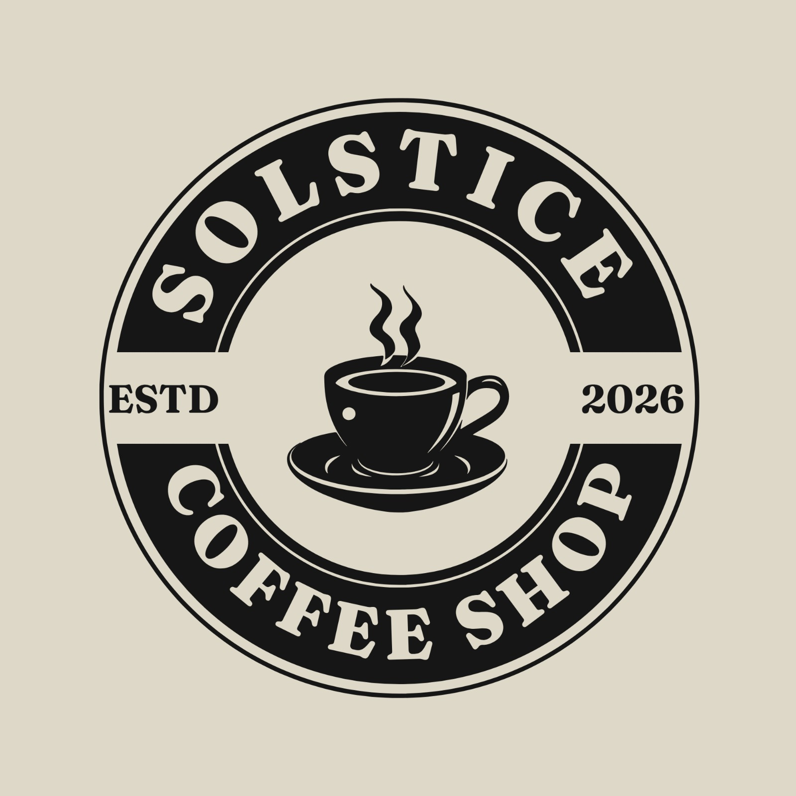

# ☕ Solstice Coffee — Coffee Shop Order System



[](https://www.php.net/)
[](https://laravel.com/)
[](https://www.postgresql.org/)
[](https://github.com/SolsticeTeam710/Solstice-)

> Proyek Uji Kompetensi Keahlian Rekayasa Perangkat Lunak (UKK RPL/PPLG)  
> **Nama aplikasi:** Solstice Coffee — Coffee Shop Order System

---

## 1. Deskripsi Proyek

Solstice Coffee adalah aplikasi web untuk membantu proses pemesanan dan pengelolaan operasional coffee shop. Aplikasi menghubungkan pelanggan, kasir, dan admin dalam satu sistem.

Dalam operasional coffee shop, pemesanan, pemeriksaan stok, konfirmasi pembayaran, dan pencatatan penjualan perlu dikelola dengan rapi. Jika proses tersebut dilakukan secara terpisah atau manual, pesanan bisa terlewat dan informasi stok maupun penjualan lebih sulit dipantau.

Solstice Coffee menyediakan pemesanan melalui QR meja, dashboard kasir untuk memproses pesanan dan pembayaran, serta dashboard admin untuk mengelola menu, stok, pengguna, dan laporan penjualan.

### Fitur utama

- **Pelanggan:** membuka menu melalui QR meja tanpa login, memilih menu yang tersedia, mengirim pesanan, dan melihat status pesanan.
- **Kasir:** melihat daftar dan rincian pesanan, mengonfirmasi atau menolak pesanan, memproses pembayaran, dan mencetak struk.
- **Admin:** mengelola menu, kategori, akun staf, stok, dan laporan penjualan.
- **Laporan:** memfilter penjualan berdasarkan periode dan metode pembayaran, mengunduh CSV, atau menggunakan fitur cetak browser untuk menyimpan sebagai PDF.
- **Pembayaran:** CASH dan QRIS. QRIS pada aplikasi ini masih simulasi dan tidak memproses uang sungguhan.

---

## 2. Matriks Teknologi yang Digunakan

| Bagian | Teknologi |
|---|---|
| Backend | PHP 8.2+, Laravel 12 |
| Frontend | Blade, JavaScript, CSS, Tailwind CSS 4 |
| Asset bundler | Vite 7 |
| Database | PostgreSQL (Supabase) |
| Autentikasi | Laravel Authentication dan Role Middleware |
| Keamanan | Hash password Laravel, validasi server, parameter binding, CSRF Middleware, dan pembatasan percobaan login/pemesanan |
| Hosting demo | Wasmer Edge |
| Pengujian | PHPUnit melalui `php artisan test` |

---

## 3. Instalasi Lokal

### Prasyarat

- PHP 8.2 atau versi lebih baru
- Ekstensi PHP yang diperlukan Laravel, termasuk `pdo_pgsql`
- Composer
- PostgreSQL
- Node.js dan npm
- Git

### Langkah instalasi

Jalankan perintah berikut di PowerShell dari folder tempat project akan disimpan:

```powershell
# 1. Clone repository ke folder Solstice
git clone https://github.com/SolsticeTeam710/Solstice-.git Solstice
Set-Location .\Solstice

# 2. Pasang dependensi PHP
composer install

# 3. Salin file konfigurasi
Copy-Item .env.example .env

# 4. Generate application key
php artisan key:generate
Buat database PostgreSQL kosong bernama solstice_db, lalu sesuaikan konfigurasi .env:
APP_NAME="Solstice Coffee"
APP_ENV=local
APP_KEY=
APP_DEBUG=true
APP_URL=http://127.0.0.1:8000

DB_CONNECTION=pgsql
DB_HOST=127.0.0.1
DB_PORT=5432
DB_DATABASE=solstice_db
DB_USERNAME=postgres
DB_PASSWORD=password_postgresql_lokal
Lanjutkan pemasangan:
# 5. Jalankan migrasi dan seeder pada database lokal
php artisan migrate --seed

# 6. Pasang dependensi frontend dan build asset
npm ci
npm run build

# 7. Siapkan storage link untuk file publik
php artisan storage:link

# 8. Jalankan server lokal
php artisan serve --host=127.0.0.1 --port=8000
Buka halaman pelanggan melalui:
http://127.0.0.1:8000/menu?meja=1
Nomor meja yang tersedia adalah 1 sampai 4. Halaman login kasir dan admin tersedia di:
http://127.0.0.1:8000/login
4. Contoh Akun Uji Coba Default
Akun kasir dan admin berikut dibuat oleh UserSeeder untuk pengujian lokal. Pelanggan tidak perlu login.
Peran	    Username	     Password Hak akses
Pelanggan	Tidak perlu login	—	         Melihat menu dan membuat pesanan melalui QR meja

Kasir	    kasir1	          password	  Memproses pesanan, mengonfirmasi atau menolak pembayaran, dan mencetak struk

Admin	     admin	          password	 Mengelola menu, kategori, pengguna, stok, dan laporan


Akun tersebut adalah akun uji coba lokal. Ganti password sebelum aplikasi digunakan dengan data atau akun sungguhan. QRIS pada aplikasi hanya simulasi.

5. Menjalankan Pengujian
Jalankan pengujian Laravel dengan:
php artisan test
Hasil pengujian terakhir:
Tests: 2 passed (4 assertions)
6. Demo Online dan Catatan Mode LAN
Aplikasi demo online:

https://solstice-coffee.wasmer.app

Halaman pemesanan pelanggan:

https://solstice-coffee.wasmer.app/menu?meja=1

Mode LAN memerlukan PostgreSQL lokal yang sudah berisi database aplikasi dan perangkat pelanggan/penguji pada jaringan WiFi yang sama. QR meja untuk mode LAN harus menggunakan alamat IP lokal laptop, bukan alamat Wasmer. Uji kamera QRIS langsung di perangkat yang akan dipakai karena QRIS aplikasi masih berupa simulasi.

7. Anggota Pengembang dan Pembagian Peran
- [Raka Herlambang]: [Frontend & UI/UX Designer]
- [Zacka Tapa Raga Alhamra]: [Backend & Database Specialist]
Sekolah: [SMK Budi Bakti Ciwidey]
Pembimbing: [Nurdiansyah Permana]
